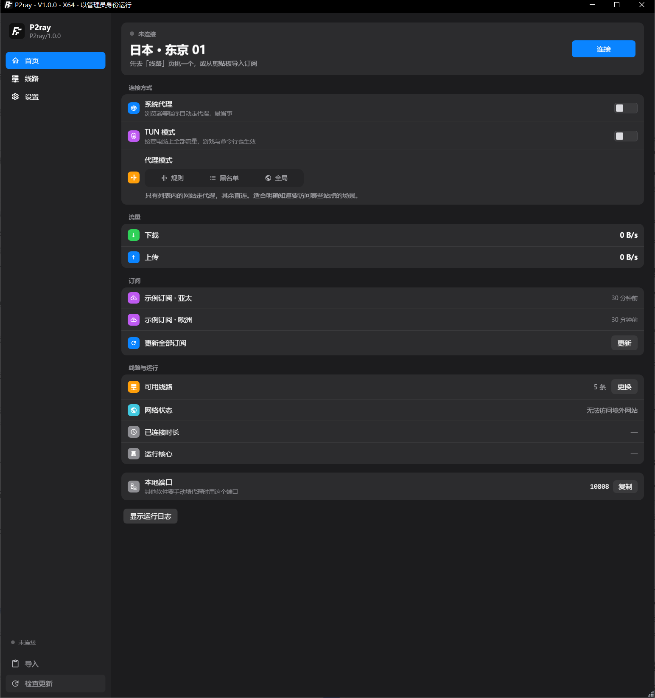
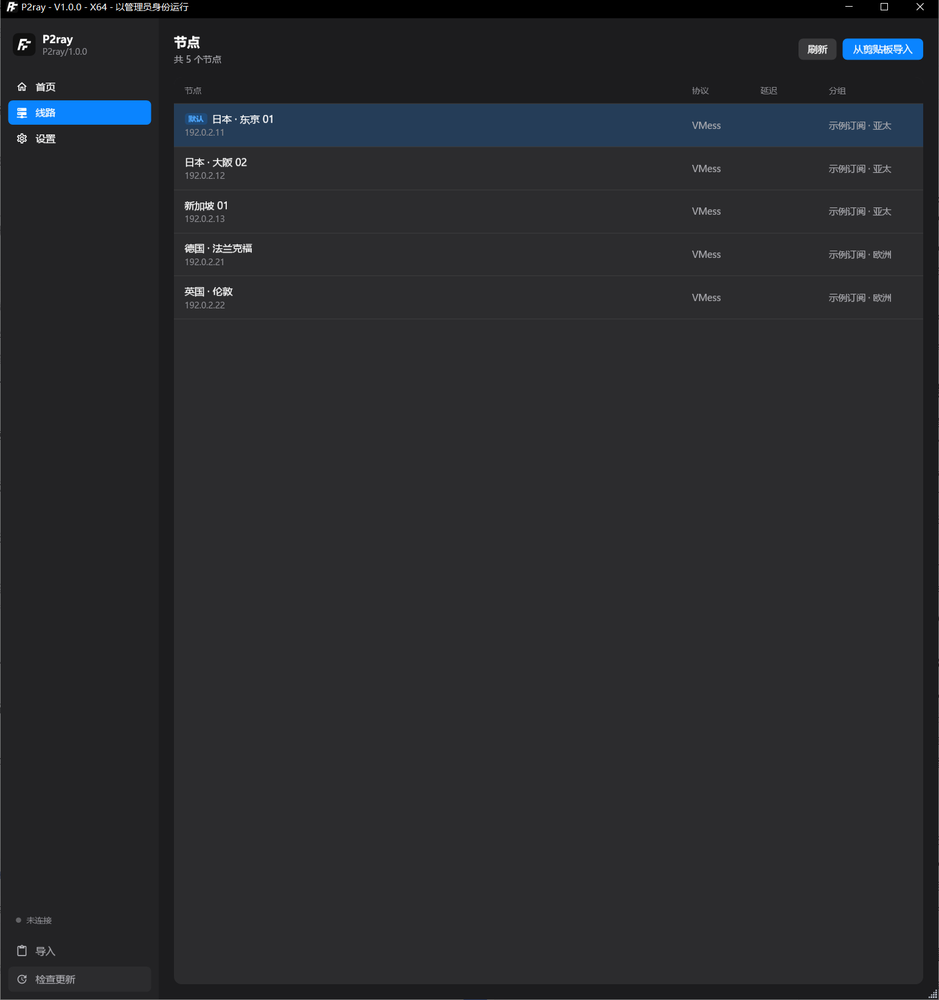
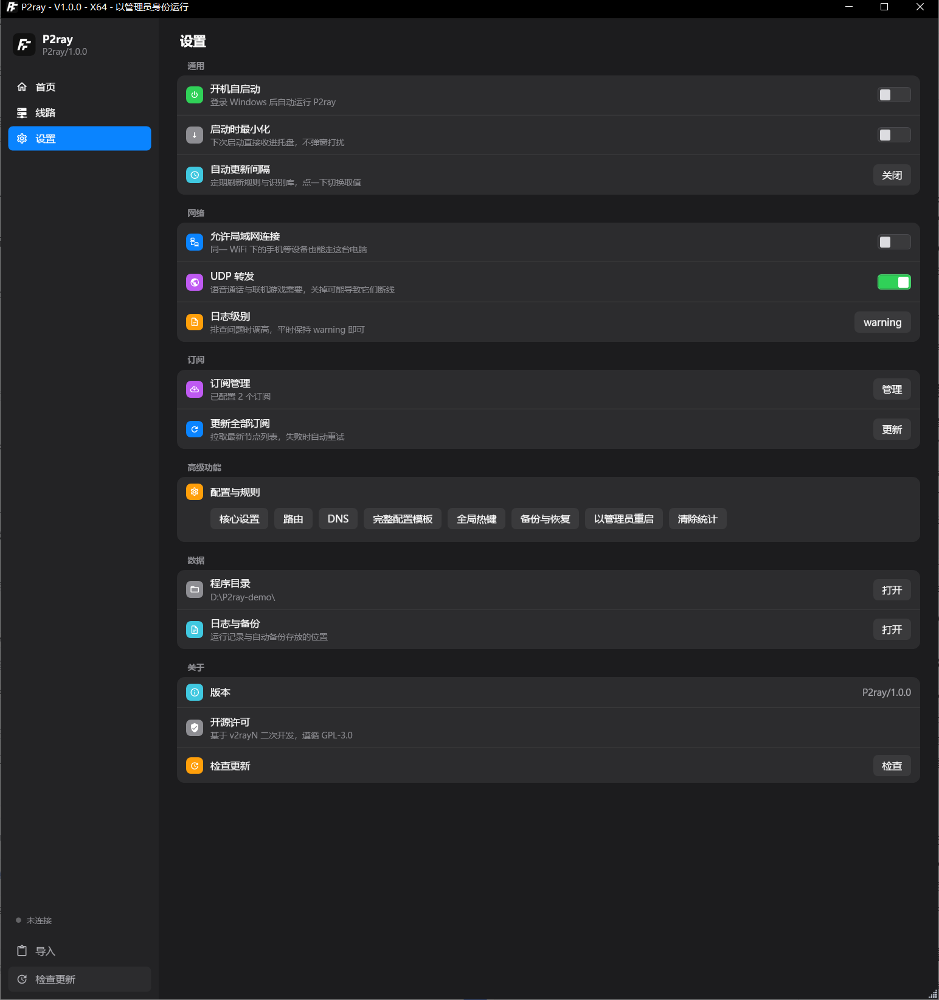

<div align="center">


# P2ray

**Windows 桌面代理客户端，界面按 macOS 系统设置的方式重做**

[](https://github.com/PAIZ1999/P2ray/actions/workflows/build.yml)
[](LICENSE)


</div>

---

## 这是什么

P2ray 是 [v2rayN](https://github.com/2dust/v2rayN) 的二次开发版本。协议层、订阅解析、内核调度全部沿用 upstream，**界面整个重做**：

- 只保留 Windows，砍掉 Avalonia 与跨平台分支
- 三页结构（首页 / 线路 / 设置），不使用标签页
- 按 macOS 系统设置的分组卡片语言重新排布：彩色行图标、细分割线、极窄字号区间
- 面向不懂网络的用户：不暴露协议名、端口、内核名等术语

## 界面

### 首页

连接开关、代理模式、流量、订阅集中在一页。



代理模式是一条 macOS 式分段控件（规则 / 黑名单 / 全局），与系统代理、TUN 开关同页，切完立即生效。

### 线路

节点与订阅分组，支持双击设为默认，`Delete` 删除。



### 设置

分组卡片式设置，改完即写盘，没有"保存"按钮。



## 下载

从 [Releases](https://github.com/PAIZ1999/P2ray/releases) 获取最新版本。

| 平台 | 文件 |
|---|---|
| Windows x64 | `P2ray-windows-64.zip` |
| Windows arm64 | `P2ray-windows-arm64.zip` |

解压后直接运行 `P2ray.exe`，内核随包分发，无需另装。每个包附带 `.sha256` 校验文件：

```powershell
Get-FileHash .\P2ray-windows-64.zip -Algorithm SHA256
```

## 功能

**协议** — VLESS / VMess / Shadowsocks / Trojan / Hysteria2 / TUIC / AnyTLS / WireGuard / SOCKS / HTTP

**内核** — [Xray-core](https://github.com/XTLS/Xray-core) 与 [sing-box](https://github.com/SagerNet/sing-box) 双内核，按节点自动选择，可在首页「运行核心」查看当前生效的引擎。版本在 `scripts/fetch-cores.ps1` 中钉扎，避免上游发版导致行为漂移。

**代理方式**

- 系统代理：改写系统 WinINET 设置，浏览器等程序自动生效
- TUN 模式：接管全部流量，游戏、命令行等不读系统代理的程序也走代理（需要管理员权限）

**代理模式** — 规则（绕过大陆）/ 黑名单 / 全局，三选一，切换后自动重载内核

**订阅**

- 导入订阅链接或剪贴板内容
- 定时自动更新，间隔可设
- 支持自定义请求头（UA / Authorization / Cookie 等），部分机场需要
- 订阅分组与手动节点分组

**其它**

- 实时速率、上下行曲线、连接时长
- 节点延迟测试与批量测速
- 自定义路由规则与 DNS
- 配置备份与恢复
- 完整配置模板（Clash / sing-box YAML）
- 开机自启、启动最小化到托盘
- 应用内检查更新（走本项目 GitHub Release）

## 从源码构建

需要 .NET 10 SDK。

```powershell
git clone https://github.com/PAIZ1999/P2ray.git
cd P2ray
pwsh ./scripts/build-release.ps1 -Runtime win-x64
```

产物在 `dist/P2ray-win-x64/`。

脚本会从上游官方 Release 拉取内核并钉扎版本，见 `scripts/fetch-cores.ps1`。SDK 不在 `PATH` 时可用 `DOTNET_ROOT` 指定：

```powershell
$env:DOTNET_ROOT = 'C:\path\to\dotnet'
pwsh ./scripts/build-release.ps1 -Runtime win-x64
```

### 开发构建

```powershell
dotnet build v2rayN/v2rayN.slnx -c Debug
dotnet test v2rayN/ServiceLib.Tests/ServiceLib.Tests.csproj
```

## 项目结构

```
scripts/
  fetch-cores.ps1     拉取并钉扎 Xray-core / sing-box
  build-release.ps1   完整发布构建
  make-icons.py       由 SVG 生成多尺寸图标
  check-contrast.py   配色对比度审计
v2rayN/
  ServiceLib/         业务逻辑（协议、订阅、配置生成、系统代理）
  ServiceLib.Tests/   单元测试
  v2rayN/             WPF 界面
  AmazTool/           自更新辅助进程
```

品牌相关的全部常量集中在 `v2rayN/ServiceLib/ProductInfo.cs`，换品牌只改这一处。

界面设计令牌集中在 `v2rayN/v2rayN/Themes/P2rayTokens.xaml`（颜色、字号、圆角、控件样式）。

## 与上游的差异

| 方面 | v2rayN | P2ray |
|---|---|---|
| 平台 | Windows / Linux / macOS | 仅 Windows |
| UI 框架 | WPF + Avalonia 双实现 | 仅 WPF |
| 界面结构 | 多窗口 + 标签页 + 顶栏工具栏 | 单窗口三页 + 侧栏导航 |
| 视觉风格 | MaterialDesign 默认 | macOS 系统设置风格 |
| 更新通道 | upstream 仓库 | 本项目仓库 |
| 更新检查 | 应用 + 内核 | 应用 + 内核（内核版本钉扎） |

协议实现、订阅解析、配置生成等核心逻辑与上游保持一致，便于同步 upstream 修复。

## 已知问题

- 仅支持 Windows 10 及以上（依赖 WinINET 与 Wintun）
- TUN 模式需要管理员权限，首次启用会请求提权
- 部分机场的订阅返回非标准格式，需在订阅设置中调整 UA

## 反馈

- [提交 Issue](https://github.com/PAIZ1999/P2ray/issues)
- 提问前请附上：系统版本、P2ray 版本（设置页「版本」）、复现步骤

## 许可

本项目遵循 [GPL-3.0](LICENSE)。

二次开发基于 v2rayN，其版权归原作者 2dust 及贡献者所有，原始版权声明保留于源码中。仓库保留了完整的上游提交历史。

随包分发的第三方组件：

| 组件 | 许可 |
|---|---|
| [Xray-core](https://github.com/XTLS/Xray-core) | MPL-2.0 |
| [sing-box](https://github.com/SagerNet/sing-box) | GPL-3.0 |
| [MaterialDesignInXamlToolkit](https://github.com/MaterialDesignInXAML/MaterialDesignInXamlToolkit) | MIT |

完整声明见 [NOTICE.md](NOTICE.md)。

### 源码获取

GPL-3.0 要求分发二进制时提供对应源码。本仓库即完整源码，任何发布版本都能在
[Releases](https://github.com/PAIZ1999/P2ray/releases) 对应 tag 下取得源码归档。
